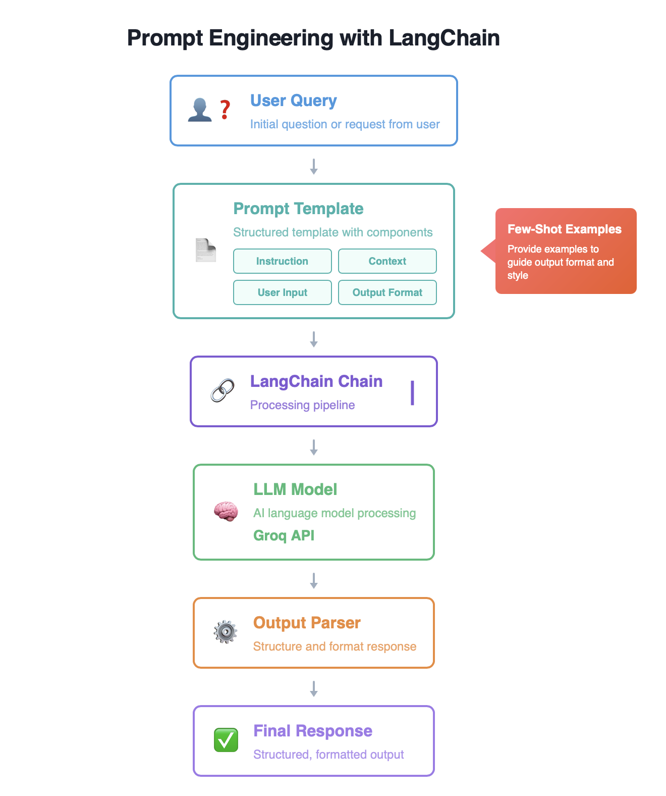

[](https://github.com/neuefische/ds-prompt-engineering/actions/workflows/workflow-02.yml)

## Prompt Engineering mit LangChain

### Einführung

**Prompt Engineering** ist die Praxis, Eingaben (Prompts) zu gestalten und zu verfeinern, um Large Language Models (LLMs) gezielt zu gewünschten Ausgaben zu lenken. Gut formulierte Prompts können die Qualität, Genauigkeit und Relevanz von KI-generierten Antworten erheblich verbessern.

**Warum ist Prompt Engineering wichtig?**
- **Kontrolle und Präzision**: Das Modell gezielt zu bestimmten Formaten, Tonalitäten oder Antworttypen lenken
- **Bessere Ergebnisse mit weniger Aufwand**: Genaue Antworten erhalten, ohne Modelle feinabstimmen oder neu trainieren zu müssen
- **Kosteneffizienz**: Modellleistung mit vorhandenen vortrainierten Modellen optimieren
- **Flexibilität**: Modellverhalten schnell für verschiedene Anwendungsfälle anpassen

**Wann Prompt Engineering einsetzen:**
- Entwicklung von Chatbots, virtuellen Assistenten oder Konversationsschnittstellen
- Aufbau von Content-Generierungssystemen (Dokumentation, FAQs, Zusammenfassungen)
- Extraktion strukturierter Informationen aus unstrukturiertem Text
- Aufbau von Retrieval-Augmented Generation (RAG)-Systemen
- Prototyping von KI-Anwendungen vor der Investition in individuelles Modelltraining

Dieser Workshop vermittelt praktische Prompt-Engineering-Techniken mit dem **LangChain**-Framework – einer beliebten Python-Bibliothek zur Entwicklung von LLM-Anwendungen – sowie Groqs kostenloser LLM-API durch praxisnahe Übungen.



**Den Workflow verstehen:**

1. **Benutzereingabe/Anfrage** – Deine Frage oder Anforderung
2. **Prompt-Template** – Strukturiert die Eingabe mit vier Komponenten:
   - **Anweisung**: Was das Modell tun soll
   - **Externer Kontext**: Zusätzliches Wissen aus Dokumenten oder Datenbanken (Quellwissen vs. parametrisches Wissen)
   - **Benutzereingabe**: Abfrage, die dynamisch über Variablen wie `{question}` eingefügt wird
   - **Ausgabeindikator**: Leitet das Antwortformat an (z. B. „Antwort:", strukturierte Formatierung)
3. **Few-Shot-Beispiele** – Beispielhafte Eingabe-Ausgabe-Paare, die dem Modell das gewünschte Format beibringen
4. **LangChain Chain** – Zusammengefügte Komponenten: `prompt_template | llm | output_parser`
5. **LLM (Groq API)** – Das Modell (`llama3-8b-8192`) verarbeitet den Prompt mit konfigurierbaren Parametern (`temperature`, `max_tokens`)
6. **Output-Parser** – Formatiert Rohantworten in nutzbare Strukturen
7. **Finale Antwort** – Aufbereitete Ausgabe für deine Anwendung

Dieser Workflow steuert das LLM-Verhalten ohne erneutes Training und ermöglicht produktionsreife Ergebnisse aus allgemeinen Modellen.

### Workshop-Struktur

Arbeite diese beiden Jupyter-Notebooks der Reihe nach durch:

1. **[1_intro_langchain.ipynb](1_intro_langchain.ipynb)** – Einführung in LangChain
2. **[2_langchain_prompt_engineering.ipynb](2_langchain_prompt_engineering.ipynb)** – Prompt Engineering mit LangChain

### Was du lernen wirst

**Notebook 1: LangChain-Grundlagen**
- Was LangChain ist und seine Kernkomponenten (Prompts, LLMs, Chains, Tools, Agenten, Memory)
- Wie LLMs (insbesondere Groqs API) mit LangChain integriert werden
- Wie Prompt-Templates mit dynamischen Eingabevariablen erstellt werden
- Wie Chains durch das Verbinden von Komponenten aufgebaut werden (`prompt | llm`)
- Wie Chains für einzelne und Batch-Anfragen aufgerufen werden

**Notebook 2: Prompt-Engineering-Techniken**
- Die 4-teilige Prompt-Struktur in der Praxis anwenden
- Kontextbasierte Frage-Antwort-Systeme mit externem Wissen
- Few-Shot-Prompting mit beispielhaften Eingabe-Ausgabe-Paaren
- Verwendung von `FewShotPromptTemplate` zur systematischen Strukturierung von Beispielen
- Chaining mit Output-Parsern für formatierte Antworten

### Voraussetzungen

- Python 3.11.3 installiert (via pyenv)
- Kostenloser Groq API-Schlüssel von der [Groq Console](https://console.groq.com/playground)
- Grundkenntnisse in Python und Jupyter Notebooks

### Einrichtungsanleitung

**1. Groq API-Schlüssel holen**
- Kostenloses Konto erstellen unter [Groq Console](https://console.groq.com/playground)
- API-Schlüssel generieren (keine Kreditkarte erforderlich)

**2. `.env`-Datei erstellen**

Erstelle eine `.env`-Datei im Stammverzeichnis des Repositories mit folgendem Inhalt:

```
GROQ_API_KEY=<dein Groq API-Schlüssel>
```

**3. Python-Umgebung einrichten**

**macOS:**

```bash
pyenv local 3.11.3
python -m venv .venv
source .venv/bin/activate
pip install --upgrade pip
pip install -r requirements.txt
```

**Windows (PowerShell):**

```powershell
pyenv local 3.11.3
python -m venv .venv
.venv\Scripts\Activate.ps1
python -m pip install --upgrade pip
pip install -r requirements.txt
```

**Windows (Git Bash):**

```bash
pyenv local 3.11.3
python -m venv .venv
source .venv/Scripts/activate
python -m pip install --upgrade pip
pip install -r requirements.txt
```

---

## Praxisanwendungen

Prompt Engineering macht KI-Anwendungen effizienter und effektiver. Anwendungsentwickler kapseln offene Benutzereingaben typischerweise in einem Prompt, bevor sie diesen an das KI-Modell weitergeben.

Beispiel: Ein Benutzer gibt eine unvollständige Anfrage ein wie „Wo kann ich ein Hemd kaufen?" Intern verwendet der Code einen ausgearbeiteten Prompt: „Du bist ein Verkaufsassistent eines Bekleidungsunternehmens. Ein Benutzer aus Alabama, USA, fragt dich, wo er ein Hemd kaufen kann. Antworte mit den drei nächstgelegenen Filialen, die derzeit Hemden auf Lager haben." Der Chatbot liefert daraufhin deutlich relevantere und präzisere Informationen. [AWS Prompt Engineering](https://aws.amazon.com/what-is/prompt-engineering/)

Die Prompt-Engineering-Techniken werden aktiv in der Produktion von großen Unternehmen weltweit eingesetzt:

**Quelle: [LangGraph in der Produktion](https://blog.langchain.com/is-langgraph-used-in-production/)**

- **Klarna**: KI-Kundensupport-Assistent für 85 Millionen aktive Nutzer, reduziert die Bearbeitungszeit um 80 %
- **LinkedIn**: KI-gestützter Recruiter zur automatisierten Kandidatensuche und SQL-Bot, der natürlichsprachliche Fragen in SQL-Abfragen umwandelt
- **Uber**: Automatisierte Unit-Test-Generierung für groß angelegte Code-Migrationen mit Multi-Agenten-Systemen
- **AppFolio**: KI-Copilot, der Immobilienverwaltern über 10 Stunden pro Woche einspart bei 2-facher Verbesserung der Entscheidungsgenauigkeit

**Quelle: [Top LangGraph Agenten in der Produktion 2024](https://blog.langchain.com/top-5-langgraph-agents-in-production-2024/)**

- **Cisco Outshift**: KI-Platform-Engineer steigert die Entwicklerproduktivität um das 10-fache und reduziert die Einrichtungszeit von CI/CD-Pipelines von einer Woche auf unter eine Stunde

**Quelle: [LangChain Anwendungsfälle – Airbyte](https://airbyte.com/data-engineering-resources/langchain-use-cases)**

- Organisationen berichten, dass LangChain-Pipelines die Bereitstellungszeit um das 3–5-fache verkürzen und manuelle Datentechnikaufgaben um bis zu 80 % reduzieren
- Wird von über 100.000 Unternehmen weltweit für Dokumenten-Q&A, konversationelle KI und automatisierte Wissenssysteme genutzt

---

## Weiterführend: Projektideen

Nach Abschluss dieses Workshops verfügst du über die Fähigkeiten, eigene Prompt-Engineering-Anwendungen zu entwickeln. Hier sind praktische Projektideen, die das Gelernte anwenden:

### 1. Bewerbungsassistent

Stellenausschreibungen analysieren und strukturierte Informationen extrahieren (Fähigkeiten, Anforderungen, Erfahrungsniveau).

**Workflow:**
1. Stellenausschreibungstext einfügen
2. Anforderungen mit Prompt-Template extrahieren
3. Fähigkeiten mithilfe von Few-Shot-Beispielen kategorisieren
4. Anschreiben-Gliederung über verketteten Prompt generieren

**Erweiterungen:** Mehrere Ausschreibungen vergleichen, maßgeschneiderte Lebenslaufpunkte generieren, Kompetenzlückenanalyse erstellen

### 2. Content-Transformationspipeline

Inhalte zwischen Formaten konvertieren (z. B. technische Dokumentation in Einsteigerleitfäden, Meetingnotizen in Aufgabenlisten).

**Workflow:**
1. Mit dem Ausgangsinhalt beginnen
2. Few-Shot-Beispiele für die gewünschte Transformation verwenden
3. Chain aufbauen: `extraction_prompt | llm | formatting_prompt | llm | output_parser`
4. Mehrere Dokumente im Batch verarbeiten

**Beispiele:** Meetingnotizen → Aufgabenlisten, Forschungsarbeiten → Zusammenfassungen, Code-Dokumentation → Tutorials

### Erste Schritte

**Wähle ein Projekt, das ein echtes Problem für dich löst.** Fang einfach an:
1. Eingabe und gewünschte Ausgabe klar definieren
2. Ein einfaches Prompt-Template mit den 4 Komponenten erstellen (Anweisung, Kontext, Eingabevariable, Ausgabeindikator)
3. Manuell mit einigen Beispielen testen
4. Few-Shot-Beispiele hinzufügen, wenn die Formatierung komplex ist
5. Chains aufbauen, wenn mehrstufige Verarbeitung benötigt wird
6. Mit Batch-Verarbeitung skalieren

**Weitere Ressourcen:**
- [LangChain-Dokumentation](https://docs.langchain.com/oss/python/langchain/overview)
- [Prompt Engineering Guide](https://www.promptingguide.ai/)
- [LangChain GitHub-Repository](https://github.com/langchain-ai/langchain)